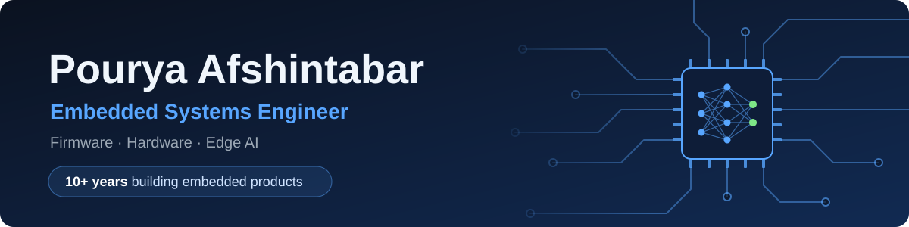

  

  
  

I build complete embedded products, from system architecture, schematics and multilayer PCBs to C/C++ firmware on bare metal, FreeRTOS and embedded Linux, and I carry them through bring-up and testing to series production. In more than ten years my work has spanned industrial automation, oil & gas, power, medical devices and IoT, and I have led hardware teams along the way. Today my focus is Edge AI: small neural networks that run directly on microcontrollers, with no cloud.

  
  
  
  
  
  
  
  
  

<table>
  <tr><td><b>Firmware</b></td><td>C, C++ (11/14/17), Python · bare metal, FreeRTOS, embedded Linux · GCC, CMake, Yocto/Buildroot</td></tr>
  <tr><td><b>Processors</b></td><td>ARM Cortex-M (ST, NXP, TI) · Cortex-A (TI Sitara, Allwinner) · ESP32 · Xilinx FPGA · TI C2000 DSP</td></tr>
  <tr><td><b>Hardware</b></td><td>Altium Designer · multilayer, high-speed and low-noise PCBs · signal and power integrity · EMI/EMC · DFM</td></tr>
  <tr><td><b>Connectivity</b></td><td>Gigabit Ethernet, PoE, CAN, RS-485, USB · Wi-Fi, BLE, LoRa · MQTT, HTTP/REST, TLS, OTA</td></tr>
  <tr><td><b>Edge AI</b></td><td>TensorFlow Lite Micro, Edge Impulse, STM32Cube.AI · quantization, pruning · CMSIS-NN</td></tr>
</table>

## Featured project

### [esp32-secure-ota](https://github.com/PATEmbedded/esp32-secure-ota): signed firmware updates for ESP32

Firmware updates over HTTPS for ESP32 and ESP32-S3 with ESP-IDF. A device in the field never installs a forged or an older image, and never stays on a broken one.

| Check | How |
|---|---|
| Server identity | TLS against the ESP-IDF certificate bundle or one pinned CA; plain HTTP is refused |
| Image origin | Only images signed with the release key: ECDSA P-256 on ESP32, RSA-3072 on ESP32-S3 |
| Integrity | SHA-256 checked before the new slot is selected, so an interrupted download never boots |
| No downgrade | The image header is read first; another project or an older version is rejected before the download goes on |
| Health after the update | The new image must pass a self-test, or the bootloader returns to the previous one |

With a written threat model, unit tests, and CI that builds and signs the firmware with ESP-IDF 5.5 and 6.0.

## Open-source libraries

<table>
  <tr>
    <td width="50%" valign="top">
      <h3><a href="https://github.com/PATEmbedded/embedded-cpp-toolkit">embedded-cpp-toolkit</a></h3>
      
Header-only firmware building blocks: a table-driven state machine, observable values, weekly schedules, JSON request validation, a debouncer and a periodic timer. No hardware dependency.

      
 

    </td>
    <td width="50%" valign="top">
      <h3><a href="https://github.com/PATEmbedded/esp32-psram-allocator">esp32-psram-allocator</a></h3>
      
Standard C++ containers in the external PSRAM of ESP32 chips, with an optional fallback to internal RAM, so large data leaves the internal RAM to Wi-Fi and FreeRTOS.

      
 

    </td>
  </tr>
  <tr>
    <td width="50%" valign="top">
      <h3><a href="https://github.com/PATEmbedded/esp32-gpio-devices">esp32-gpio-devices</a></h3>
      
Debounced buttons with click, multi-click and long-press events, and outputs that blink and pulse. One task handles them all and sleeps while nothing happens.

      
 

    </td>
    <td width="50%" valign="top">
      <h3><a href="https://github.com/PATEmbedded/esp32-time-sync">esp32-time-sync</a></h3>
      
SNTP with time zones, a status that says how far the clock can be trusted, and a sensible clock after a power cut instead of 1970.

      
 

    </td>
  </tr>
</table>

Every repository here is built the same way:

- unit tests on a PC with GCC and Clang, under AddressSanitizer and UndefinedBehaviorSanitizer
- firmware and example builds in CI, for ESP-IDF 5.5 and 6.0 where ESP-IDF is used
- documentation with diagrams and examples, a changelog, tagged releases and the MIT license

---

**Contact:** [pat.embedded@gmail.com](mailto:pat.embedded@gmail.com) · [LinkedIn](https://www.linkedin.com/in/pourya-afshintabar/)
